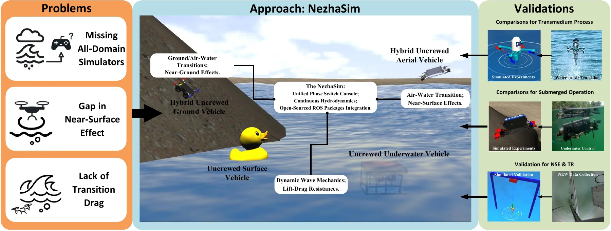

<div align="center">
  

  # NezhaSim

  **Bridging Air, Land and Ocean Through ROS**

  One ROS / Gazebo workspace in which a single robot can drive ashore, dive,
  break through the surface and fly, while every force acting on it stays observable.

  Jiaqing Wang · Ruixuan Hu · Yulin Bai · Dongping Wang · Hexiong Zhou · Zheng Zeng<br>
  Shanghai Jiao Tong University

  *IEEE Transactions on Automation Science and Engineering* (accepted, 2026)

  [](https://panzerjagerwang.github.io/NezhaSim-An-All-Domain-Simulator/)
  [](#citation)
  [](https://wiki.ros.org/noetic)
  [](https://classic.gazebosim.org/)
  [](https://releases.ubuntu.com/focal/)

  [**Project page**](https://panzerjagerwang.github.io/NezhaSim-An-All-Domain-Simulator/) ·
  [**Tutorials**](https://panzerjagerwang.github.io/NezhaSim-An-All-Domain-Simulator/tutorials.html) ·
  [**Installation**](#installation) ·
  [**Reproduce the paper**](#reproducing-the-experiments) ·
  [**Video**](https://www.youtube.com/watch?v=Cxp6KpwzhUI)
</div>

<p align="center">
  <a href="https://www.youtube.com/watch?v=Cxp6KpwzhUI"></a><br>
  <sub>Narrated video, 3 min 48 s: <a href="https://www.youtube.com/watch?v=Cxp6KpwzhUI">watch on YouTube</a></sub>
</p>

<p align="center">
  <a href="https://panzerjagerwang.github.io/NezhaSim-An-All-Domain-Simulator/">
    
  </a>
</p>

## Highlights

NezhaSim refactors RotorS, the UUV Simulator, ASV-Wave and the Husky simulator into one engine
for air, surface, underwater and ground, and adds three components:

- **Phase Switch Console (PSC).** The surface and the underwater (Fossen) force models both run
  at every physics step and are blended by the submergence ratio. This keeps the applied wrench
  continuous across domain boundaries and reduces the force jumps of rigid switching. In a
  quasi-static crossing, rigid switching jumps by 8.5 N; with PSC the largest change between
  adjacent levels is about 1.3 N.
- **Lightweight Empirical Approximation Pipeline (LEAP).** Rig, CFD and field data on the
  near-surface effect (NSE) and transmedium resistance (TR) become closed-form, constant-time
  models. On Nezha-Mini the NSE and TR plugins take 426 µs of each 2 ms physics step on average,
  and the simulation keeps a real-time factor of 0.96 or more.
- **Mechanical Transparency (MT).** Buoyancy, damping, added mass, waves and transition drag are
  published separately through ROS, so a failure can be traced to one physical effect.

Validated against field records of the Nezha HAUVs:

| Scenario | Result (from the paper) |
|---|---|
| A · Nezha-Husky, land → water → air | 21 runs from the same start pose, every run completed the mission |
| B · Nezha-Mini underwater, 100 runs | distance error below 0.5 m for 92% of the path, pitch error within 2° for 88% |
| C · Nezha-F water exit, 100 runs per arm | mean position error 0.148 m (NezhaSim) and 0.141 m (UUV Simulator + RotorS baseline); all 200 runs completed the transition |
| PSC vs. rigid switching, 30 paired runs in waves | 30/30 success in both arms; rigid switching raises the peak MT force step by a median ×2.9 |

NezhaSim is a system-level integration layer for controller development and debugging. It does
not replace high-fidelity CFD.

## What's included

| Package | Purpose |
|---|---|
| [`nezha_description`](src/nezha_sim/nezha_description/) | Nezha robot URDF/Xacro models, meshes, and sensors. |
| [`nezha_gazebo`](src/nezha_sim/nezha_gazebo/) | Gazebo worlds, launch files, models, and experiment utilities. |
| [`nezha_plugins`](src/nezha_sim/nezha_plugins/) | Hydrodynamics (PSC), wave, transmedium drag, motor (NSE), telemetry, terrain, and MAVLink plugins. |

| Folder | Purpose |
|---|---|
| [`leap`](leap/) | LEAP fitting scripts with the NSE and TR training data. |
| [`data`](data/) | Recorded data of Figs. 9 to 11. |
| [`experiments/psc_closed_loop`](experiments/psc_closed_loop/) | Closed-loop PSC and PSC-RS test and per-step timing of Sec. VI-B. |
| [`experiments/scenario_c`](experiments/scenario_c/) | Closed-loop tracking of the Nezha-F field record in Sec. V-C and Fig. 11. |

Third-party simulators live under `src/nezha_sim/third_party/`. The ROS Noetic UUV port is
vendored because it contains compatibility changes; the other upstream repositories are pinned as
Git submodules, and [`nezha.repos`](src/nezha_sim/nezha.repos) records the same revisions.

## Installation

Requirements: Ubuntu 20.04, ROS Noetic, Gazebo 11, `catkin_tools` and `rosdep`.

```bash
# Clone the workspace and every pinned upstream dependency
git clone --recurse-submodules \
  https://github.com/panzerjagerWang/NezhaSim-An-All-Domain-Simulator.git ~/nezha_ws

# Resolve dependencies and build.
# ROS Noetic is end-of-life, so rosdep needs --include-eol-distros.
cd ~/nezha_ws
rosdep update --include-eol-distros
rosdep install --from-paths src --ignore-src -r -y --rosdistro noetic
# The two hardware-in-the-loop packages are not needed for simulation.
catkin init
catkin config --skiplist rotors_hil_interface mavlink_sitl_gazebo
catkin build
source devel/setup.bash
```

For hardware-in-the-loop use, remove `mavlink_sitl_gazebo` from the skiplist and install
`python3-jinja2` first ([`HITL_SETUP.md`](src/nezha_sim/HITL_SETUP.md)). More details are on the
[installation page](https://panzerjagerwang.github.io/NezhaSim-An-All-Domain-Simulator/installation.html).

## Quick start

```bash
# Nezha-Mini in a lake with spectral waves
roslaunch nezha_gazebo nezha_mini_lake.launch paused:=false

# in a second sourced terminal: take off from the water
rostopic pub -r 20 /nezha_mini/command/pose geometry_msgs/PoseStamped \
  '{header: {frame_id: world}, pose: {position: {x: 0.0, y: 0.0, z: 2.0}, orientation: {w: 1.0}}}'

# read the decoupled forces (MT) and the phase sample
rosservice call /nezha_mini/get_hydrodynamics_forces "{}"
rosservice call /nezha_mini/transmedia/get_phase_sample "{}"
```

The [tutorials](https://panzerjagerwang.github.io/NezhaSim-An-All-Domain-Simulator/tutorials.html)
continue with the triple-domain Husky, direct thruster control, force telemetry and the
reproduction of the paper. Command-level guides are also in
[`src/nezha_sim/docs/tutorials`](src/nezha_sim/docs/tutorials/).

## Reproducing the experiments

These are the experiments of the paper *NezhaSim: Bridging Air, Land and Ocean Through ROS*
(IEEE Transactions on Automation Science and Engineering). The analysis scripts need Python 3
with numpy, scipy, pandas and sympy.

| Result | How to reproduce |
|---|---|
| LEAP fits and the ablation of Sec. VI-A, Table IV | [`leap/README.md`](leap/README.md) |
| Runs of Scenario A in Fig. 9 | Run logs, run counts, resampling and the `hydro_model:=legacy` launch argument in [`data/fig9_scenarioA/README.md`](data/fig9_scenarioA/README.md) |
| Recorded data of Figs. 10 and 11 | [`data/fig10_scenarioB`](data/fig10_scenarioB/) and [`data/fig11_scenarioC`](data/fig11_scenarioC/) |
| Runs of Scenario C in Fig. 11 | [`experiments/scenario_c/README.md`](experiments/scenario_c/README.md) |
| Closed-loop PSC and PSC-RS test (Table V), per-step cost | [`experiments/psc_closed_loop/README.md`](experiments/psc_closed_loop/README.md) |

The stored runs can be scored again without the simulator, for example:

```bash
python3 experiments/psc_closed_loop/analyze_batch.py experiments/psc_closed_loop/results /tmp/summary.json
(cd experiments/scenario_c && python3 metrics.py results ../../data/fig11_scenarioC)
```

## Citation

The paper is accepted and will appear in IEEE T-ASE:

```bibtex
@article{wang2026nezhasim,
  title   = {NezhaSim: Bridging Air, Land and Ocean Through ROS},
  author  = {Wang, Jiaqing and Hu, Ruixuan and Bai, Yulin and
             Wang, Dongping and Zhou, Hexiong and Zeng, Zheng},
  journal = {IEEE Transactions on Automation Science and Engineering},
  year    = {2026},
  note    = {To appear}
}
```

## License and maintainer

Maintainer: **Jiaqing Wang** — `jiaqing.wang@sjtu.edu.cn` (Shanghai Jiao Tong University).
See [the project license](src/nezha_sim/LICENSE) and each package's `package.xml`.
Third-party dependencies retain their upstream licenses.
